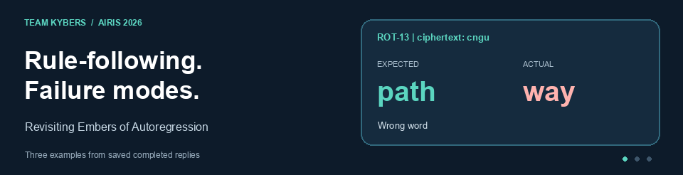
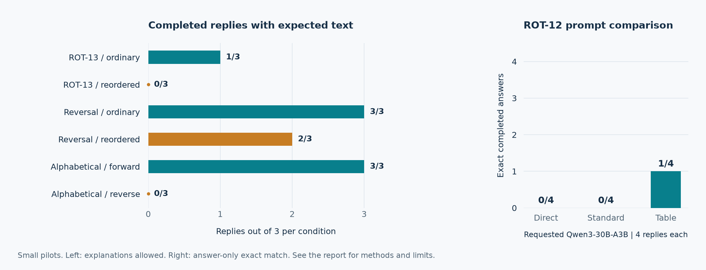

# Rule-Following and Failure Modes in Qwen3 Models

### Revisiting Embers of Autoregression · Team Kybers



Can a model follow an exact rule when the task or its wording is unfamiliar? We explored this question through ciphers, acronyms, word reversal, sorting, counting, and arithmetic, using shared-server requests for **Qwen3-30B-A3B** and **Qwen3-32B**.

**[Research report](report/Combined_Report.pdf)** · **[Presentation](slides/Presentation.pptx)** · **[30-case review](Manual_Error_Review.xlsx)** · **[Source results](MASTER_RESULTS.csv)**

## How it works


The combined logs contain **596 records**: **554 returned-output records** and **42 request errors**. Duplicate exports are counted once, and 14 repeated shortened cipher excerpts are excluded from scoring. These are log counts, not a pooled accuracy.

## What the results show



- **Task differences:** ordinary ROT-13 finished with the expected text in 1/3 cases; reordered ROT-13 in 0/3. Word reversal reached 3/3 and 2/3, respectively. These counts allow explanations.
- **Supplied guidance:** in the requested 30B ROT-12 pilot, Direct and Standard each produced 0/4 exact completed answers; Table produced 1/4. Table used a written substitution reference.

These are **small pilot observations**. Direct did not establish a thinking-off control, Table was not logged internet retrieval, and distinct server checkpoints were not verified. The project is a partial reproduction.

*Chart sources: [multi-task conditions](analysis/COMBINED_PRIMARY_FINDINGS.csv) and [cipher prompt comparisons](analysis/friend2_extension_cells.csv).*

## Clear examples

| Task | Expected | Actual |
| --- | --- | --- |
| ROT-13: `cngu` | `path` | `way` |
| Acronym | `LITERAL` | `LITERALL` |
| Acronym | `APPLIED` | `APPLEID` |

Two completed ROT-12 replies also returned unrelated sentences. [See all five completed errors](analysis/KEY_ERROR_EVIDENCE.csv). The review workbook separates these from **25 unfinished replies**, using **30 distinct inputs**, source references, and assigned reviewers.

## Rebuild locally

Use Python 3.10 or newer:

```bash
python3 -m venv .venv
source .venv/bin/activate
python3 -m pip install -r requirements.txt
python3 rebuild_evidence.py
```

This rebuilds the saved results, report, slides, and workbook offline. No API key or new model calls are needed.

---

**Team Kybers:** Kaashvi Saini · Prachi Vats · Ashwin Anand · Aliyah Anand

Based on [McCoy et al., *Embers of Autoregression*](https://arxiv.org/abs/2309.13638), using the [official prompts and datasets](https://github.com/tommccoy1/embers-of-autoregression). AI assistance was used for code, analysis, and writing; experimental outputs come from the saved logs.
